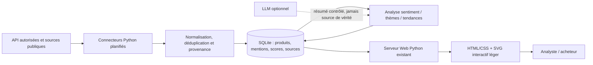
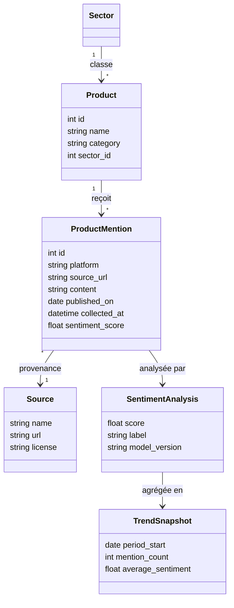
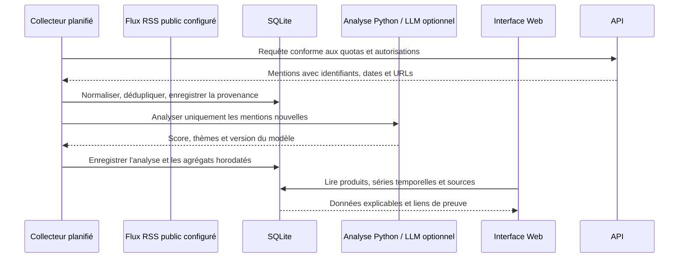

# Flash Insights

Prototype web local en français pour le projet **Make AI Happen** : collecte et traçabilité des données, détection de signaux, génération d'études et validation humaine.

## Lancer l'application

Prérequis : Python 3.10 ou plus récent.

Dans PowerShell, depuis ce dossier :

```powershell
py -3 -m venv .venv
.\.venv\Scripts\Activate.ps1
python -m pip install -r requirements.txt
Copy-Item .env.example .env
notepad .env
python app.py
```

Dans `.env`, renseignez `LLM_API_KEY` avec votre clé Gemini. Le fichier est local et ignoré par Git. L'application lit cette clé au démarrage ; redémarrez-la après toute modification. Ouvrir ensuite <http://127.0.0.1:8000>. Arrêter le serveur avec `Ctrl+C`.

Pour les sessions PowerShell suivantes, réactivez l'environnement avec `.\.venv\Scripts\Activate.ps1`. La configuration facultative des clés de collecte est décrite plus bas.

Le fichier `flash_insights.db` est créé automatiquement dans ce dossier. Pour choisir un autre emplacement, définir la variable `FLASH_INSIGHTS_DB` avant le lancement.

## Tests

```powershell
.\.venv\Scripts\python.exe -m unittest discover -s tests -v
```

## Parcours couvert

1. **Données & sources** : gérer le catalogue des sources, saisir les observations avec leur secteur, leur date et leur URL d'origine, et configurer les seuils de détection.
2. **Signaux & alertes** : associer un signal aux données qui l'étayent. Python calcule un score explicable à partir de la fiabilité des sources distinctes. Une alerte est créée si le seuil de confiance *et* le nombre minimal de sources indépendantes sont atteints. La fiche de chaque signal détaille ses sources, les mesures antérieures comparables et les seuils ; l'analyste peut ensuite le confirmer ou l'écarter explicitement.
3. **Études** : créer un benchmark, une enquête ou une étude sectorielle. Le rapport en brouillon reprend jusqu'aux 30 observations les plus récentes du secteur. Chaque chiffre reste lié à la donnée et à sa source d'origine.
4. **Contrôle & diffusion** : soumettre le brouillon à un validateur, historiser une validation ou une demande de correction, régénérer une version, puis diffuser le livrable validé au client de démonstration.
5. **Historique** : retrouver les principales actions et décisions enregistrées.
6. **Réputation des produits** : comparer des produits, saisir des avis avec leur provenance, suivre une courbe hebdomadaire de sentiment, dégager des mots récurrents et afficher les sources sous chaque indicateur. Les secteurs et catégories sont configurables depuis l'interface.

## Modèle de score

Le score de confiance est la moyenne de la fiabilité des sources distinctes liées aux données, ramenée à une échelle de 0 à 1 (fiabilité de 1 à 5 divisée par 5). Plusieurs observations d'une même source ne comptent que comme une seule source indépendante. Les seuils initiaux sont de 0,60 et deux sources indépendantes ; ils peuvent être modifiés par secteur.

## Limites du prototype

- Les données initiales sont fictives et signalées comme telles dans l'interface.
- La collecte automatisée est disponible mais nécessite la configuration explicite d'un flux RSS ou de clés API autorisées ; aucune clé ni aucun flux n'est fourni. Les produits et avis peuvent aussi rester saisis manuellement ; aucune source KPMG ni authentification générale n'est configurée. L'analyse LLM est facultative.
- Les compteurs du tableau de bord reflètent la base locale et affichent la date de la dernière collecte enregistrée ; ils ne signifient pas que les données sont actualisées en continu.
- Sans LLM configuré ou si son API échoue, le sentiment des avis revient au lexique local ; cette heuristique comprend mal le sarcasme, la négation, la langue et le contexte. Les indicateurs ne constituent pas une évaluation certifiée de la qualité d'un produit.
- Les exemples d'avis et leurs liens `example.org` sont fictifs. Le volume de mentions enregistrées n'est pas une mesure représentative de la popularité du marché.
- Le « générateur » produit un rapport déterministe à partir des données disponibles ; il ne fabrique ni valeurs ni conclusions prédictives.
- La validation est une démonstration de workflow local, pas un contrôle d'accès : ne pas y enregistrer de données confidentielles ou personnelles.
- Le serveur écoute uniquement sur `127.0.0.1`. Pour un déploiement partagé, ajouter une authentification, des contrôles d'accès, une protection CSRF et un serveur WSGI/ASGI adapté.

## Structure

- `app.py` : routes HTTP, logique Python, schéma SQLite et données fictives initiales.
- `collector/` : normalisation, déduplication, analyse LLM facultative, connecteurs autorisés et worker planifié.
- `static/style.css` : interface responsive.
- `tests/` : tests unitaires du scoring, du workflow d'étude et de la collecte locale.

## Module de réputation des produits

La page **Réputation produits** conserve les écrans existants et ajoute :

- des produits liés aux secteurs existants, avec une catégorie libre, et la création de secteurs personnalisés ;
- la saisie d'une publication / d'un avis avec plateforme, source, URL, date de publication et date de collecte ;
- un score heuristique moyen entre -1 et +1, une étiquette verte / orange / rouge, un feedback et des points forts/faibles ;
- une courbe SVG sans dépendance externe : évolution hebdomadaire du sentiment et barres du volume de mentions ; la comparaison se fait par sélection de plusieurs produits ;
- une liste de sources cliquables sous chaque carte et une détection exploratoire de termes plus fréquents au cours des 30 derniers jours.
- une déduplication des publications par produit et URL source.

Les tables SQLite liées au module sont `products`, `product_mentions` et `collection_runs`. Les relations existantes (`sectors`, `activity_logs`) sont réutilisées. L'initialisation crée les tables et index de manière idempotente et ajoute des exemples uniquement si le catalogue de produits est vide.

### Analyse LLM facultative

L'application utilise Gemini via son endpoint compatible avec OpenAI Chat Completions. Le texte d'article facultatif sur **Données & sources** permet d'extraire un indicateur, sa valeur, son unité et un secteur existant. Les avis saisis sur **Réputation produits** peuvent être analysés pour le score de sentiment et les points forts/faibles, lesquels sont enregistrés avec l'avis dans SQLite. En cas d'absence de clé, d'erreur API ou de réponse invalide, l'extraction retombe sur les champs saisis manuellement et le sentiment sur le lexique local ; l'interface indique ce recours.

Configurer les variables avant de démarrer le serveur :

Le modèle par défaut est `gemini-3.8-flash` et l'endpoint est `https://generativelanguage.googleapis.com/v1beta/openai/chat/completions`. Ces valeurs et `LLM_API_KEY` peuvent être configurées dans `.env`. Sans clé, l'application conserve son analyse locale et le traitement LLM n'est pas activé.

Pour activer l'analyse distante, `LLM_API_KEY` est obligatoire ; `LLM_API_BASE_URL` et `LLM_MODEL` ont les valeurs illustrées ci-dessus par défaut. Sans clé, l'analyse des avis utilise le lexique local. Les avis fictifs ajoutés à l'initialisation sont toujours analysés localement et ne déclenchent pas d'appel API. La clé reste dans l'environnement du processus : ne pas la mettre dans le code, la base, ni un fichier versionné. Le collecteur ne transmet au LLM que le texte public de la mention (jamais l'auteur ni les autres métadonnées) ; vérifiez les conditions du fournisseur et n'envoyez aucun contenu personnel ou confidentiel.

Créer une clé Gemini dans [Google AI Studio](https://aistudio.google.com/apikey). Le modèle par défaut est `gemini-3.8-flash`, accessible via l'endpoint compatible OpenAI. Les appels Gemini peuvent être soumis à des quotas et à des frais selon le compte et l'usage. La clé reste privée et ne doit pas être enregistrée dans le code ou la base.

Le flux RSS ne nécessite pas de clé : configurez uniquement des flux publics autorisés dans `RSS_FEEDS`, avec le format `URL|product_id|nom de source`, les entrées étant séparées par `;`. Le produit doit exister dans `products`. RSS est le seul connecteur de collecte disponible ; aucun appel YouTube, X ou Tavily n'est effectué.

### Collecte automatisée

Le worker `collector.worker` s'exécute dans un processus séparé du serveur Web, écrit ses journaux JSON dans `collector.log` et stdout, active WAL pour SQLite et refuse un second worker via `collector.lock`. Il s'arrête proprement sur Ctrl+C / SIGTERM. Pour démarrer :

```powershell
.\.venv\Scripts\Activate.ps1

# Serveur Web
python app.py

# Collecteur RSS planifié, dans un autre terminal
python -m collector.worker
```

Collecte RSS unique, sans démarrer la boucle :

```powershell
python -m collector.worker --once
```

Variables d'environnement :

| Variable | Valeur par défaut / exemple | Rôle |
| --- | --- | --- |
| `ENABLED_CONNECTORS` | `rss` | `rss`, ou `none` / `off` pour désactiver la collecte |
| `RSS_FEEDS` | `https://example.org/feed.xml\|1\|Exemple` | Flux publics autorisés, format décrit ci-dessus |
| `COLLECT_INTERVAL_SECONDS` | `300` | Pause entre collectes planifiées, en secondes |
| `COLLECTOR_MAX_ITEMS_PER_RUN` | `10` | Maximum d'éléments traités par exécution |
| `LLM_MIN_REQUEST_INTERVAL_SECONDS` | `15` | Pause minimale entre appels Gemini du collecteur |
| `LLM_API_KEY` | non défini | Clé Gemini (facultative) |
| `LLM_API_BASE_URL` | `https://generativelanguage.googleapis.com/v1beta/openai/chat/completions` | Endpoint Gemini compatible OpenAI |
| `LLM_MODEL` | `gemini-3.8-flash` | Modèle Gemini utilisé pour l'analyse |
| `COLLECTOR_ADMIN_TOKEN` | non défini | Active le bouton local de collecte manuelle et l'endpoint protégé |

Ne placez jamais de clé réelle dans le code, SQLite, la documentation ou un fichier versionné. `POST /admin/collect-now` répond 404 si `COLLECTOR_ADMIN_TOKEN` n'est pas défini ; s'il l'est, l'adresse du client doit être locale et le jeton doit être saisi dans le formulaire.

#### Comment vérifier la traçabilité d'une mention

Chaque mention conserve son connecteur, son hash de déduplication, son URL, sa date de collecte, l'origine de l'analyse et, le cas échéant, la version du modèle. La requête suivante relie la mention au produit et affiche la provenance enregistrée :

```sql
SELECT m.id, p.name AS product, m.platform, m.source_name, m.source_url,
       m.connector, m.raw_hash, m.collected_at, m.analysis_source,
       m.model_version, m.published_on
FROM product_mentions AS m
JOIN products AS p ON p.id = m.product_id
ORDER BY m.collected_at DESC;
```

Vérifier qu'aucun doublon de clé `(product_id, raw_hash)` ne subsiste :

```sql
SELECT product_id, raw_hash, COUNT(*) AS copies
FROM product_mentions
WHERE raw_hash IS NOT NULL
GROUP BY product_id, raw_hash
HAVING COUNT(*) > 1;
```

La contrainte unique `ux_mentions_dedup` rend les insertions idempotentes ; les répétitions sont comptabilisées dans `collection_runs.duplicates_skipped`.

### Architecture cible (proposition)





Le diagramme de classes décrit le **modèle cible normalisé** : dans cette première implémentation, la source est conservée directement dans chaque `product_mentions` (nom, plateforme, URL et dates), et les scores d'agrégat sont recalculés depuis les avis. Les tables `Source`, `SentimentAnalysis` et `TrendSnapshot` du diagramme sont des pistes d'évolution, pas des tables déjà créées.



### Technologies supplémentaires (options, non installées)

| Composant | Rôle | Choix proposé |
| --- | --- | --- |
| Flux RSS publics | Collecte de publications autorisées avec URL de preuve | Configuration explicite par flux ; ne pas supposer que le flux couvre tout le marché |
| `urllib` (stdlib) ou `httpx` | Appels HTTP vers les API | `urllib` suffit pour un prototype ; `httpx` apporte délais, pools et requêtes asynchrones en production |
| `APScheduler` ou ordonnanceur système | Déclenchement régulier des collectes | Processus worker séparé ; pas de tâche lourde dans une requête Web |
| `scikit-learn` / lexique multilingue validé | Classifieur local reproductible de sentiment / thèmes | Évaluer sur des avis français annotés avant toute décision d'achat |
| LLM optionnel via API ou modèle local | Synthèse argumentée à partir de passages sourcés | Envoi minimal, consentement/licence et contrôle des hallucinations ; conserver les preuves et le modèle |
| `Chart.js` (optionnel) | Graphiques riches et interactions | Le MVP utilise SVG généré côté serveur ; ajouter une bibliothèque seulement si zoom/filtres avancés sont nécessaires |

SQLite reste adapté à un prototype local monoposte. Si plusieurs collecteurs ou utilisateurs écrivent simultanément, prévoir une file de tâches et envisager PostgreSQL plutôt que de multiplier les écritures concurrentes SQLite. Le serveur actuel est local, sans authentification ni protection CSRF : il n'est pas prêt pour un service public.

### Modèle Gemini

Gemini est le seul service d'IA distant configuré par l'application. Les avis peuvent aussi être analysés par le lexique local lorsque Gemini n'est pas configuré ou indisponible. Les modèles et leurs capacités évoluent ; vérifier le nom exact, les quotas et les tarifs dans la [documentation officielle des modèles Gemini](https://ai.google.dev/gemini-api/docs/models) et la [page des tarifs](https://ai.google.dev/gemini-api/docs/pricing).